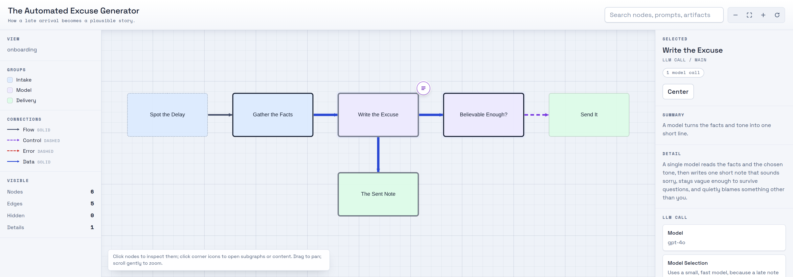

<!--
  GitHub repo settings (Settings > General) — kept here so they survive UI resets:
    Description: Turn a codebase, workflow, or prompt pipeline into a polished, interactive HTML flowchart — a skill for AI coding agents.
    Topics: ai-skill, flowchart, visualization, claude-code, codex-cli, kimi-cli, opencode, cytoscape, developer-tools, onboarding
-->

<h1 align="center">Flowchart</h1>

<p align="center">
  <em>Turn a gnarly codebase, workflow, or prompt pipeline into a polished, interactive flowchart you can actually explore.</em>
</p>

<p align="center">
  <a href="LICENSE"></a>
  <a href="https://github.com/danshapiro/skill-flowchart/pulls"></a>
  <a href="#getting-started"></a>
</p>

---

Flowchart is a **skill** for AI coding agents — Claude Code, Codex CLI, Kimi CLI, and OpenCode. Point your agent at a
system and ask for a flowchart; it reads the real code, builds a hierarchy, and renders a single self-contained HTML
file that stays simple at the top and lets you drill into detail on demand.

And since you're here for flowcharts, here's the skill's own output — an interactive map of a wholly serious system, rendered by the tool itself:

<p align="center">
  
</p>

<sub>A real screenshot of the generated single-file HTML app: a sparse overview up top, colour-coded groups, an explicit retry loop, and a click-to-inspect panel showing the selected step's model and verbatim prompt. Rendered from <a href="assets/demo-excuse-data.json"><code>assets/demo-excuse-data.json</code></a> — see <a href="#what-you-get">What you get</a>.</sub>

## Getting Started

### If you are human

Tell your favorite coding agent:

> Read https://raw.githubusercontent.com/danshapiro/skill-flowchart/main/README.md and follow the installation instructions there.

### If you've been sent here by your human

Clone this repo into your agent's skills directory. Note the clone target folder is `flowchart` (the skill name), not the repo name:

- **Claude Code:** `git clone https://github.com/danshapiro/skill-flowchart.git ~/.claude/skills/flowchart`
- **Codex CLI:** `git clone https://github.com/danshapiro/skill-flowchart.git ~/.codex/skills/flowchart`
- **Kimi CLI:** `git clone https://github.com/danshapiro/skill-flowchart.git ~/.kimi/skills/flowchart`
- **OpenCode:** `git clone https://github.com/danshapiro/skill-flowchart.git ~/.config/opencode/skills/flowchart`

> **Note:** OpenCode also discovers skills in `~/.claude/skills/`, so if you already installed it for Claude Code, OpenCode can use it too.

After cloning, read `SKILL.md` so you can explain the workflow and run it when asked.

## Requirements

- **`python3`** — required. The renderer (`scripts/render_flowchart.py`) uses only the Python standard library; there is nothing to `pip install`.
- **Node.js + Playwright** — optional, only for the QA linter and screenshots (`scripts/lint_flowchart_html.js`). Install with `npm i playwright && npx playwright install chromium`.

The rendered `.html` loads Cytoscape.js, Chroma.js, and Prism.js from a CDN. Ask for vendored copies if you need it to work fully offline.

## Using it

Just ask, and include the word **flowchart**:

> Make an interactive **flowchart** of this repo's request pipeline.

The agent decides who the diagram is for (onboarding, debugging, or change planning), maps the real system, lays out a
hierarchy, renders the HTML, lints it, and hands you a single file — with no leftover intermediates.

Under the hood it runs:

```bash
python3 scripts/render_flowchart.py flowchart-data.json output-flowchart.html
node    scripts/lint_flowchart_html.js output-flowchart.html --screenshot /tmp/output-flowchart.png
```

## What you get

A single, self-contained `.html` file that:

- Opens with a sparse **5–9 node overview** you can grok in under a minute.
- Expands any node into a **modal drilldown** — subgraphs, prompts, templates, or artifacts — one layer at a time.
- Shows **LLM calls as first-class nodes**, with their verbatim prompts (syntax-highlighted) and model details attached.
- Makes **loops, branches, and joins explicit**, with plain-language notes on why each path exists.
- Uses **color only when it means something** (actor, subsystem, trust boundary) and hides the legend when it doesn't.

## How it works

The agent does the thinking; the scripts just package it. It builds a hierarchical, dotfile-style model of the system,
writes an intermediate `flowchart-data.json` ([data model](references/data-model.md)), and renders it through a bundled
HTML shell. A linter then checks the output for the visual failure classes that make diagrams unreadable — overlapping
shapes, edges routed behind nodes, clipped labels, tiny fonts — and the agent inspects screenshots before delivering.
See [SKILL.md](SKILL.md) for the full workflow and [references/composition-guide.md](references/composition-guide.md)
for the layout heuristics.

## Repo layout

```
SKILL.md                            # the skill: workflow, rules, quality gate
scripts/render_flowchart.py         # JSON -> interactive HTML (stdlib only)
scripts/lint_flowchart_html.js      # visual QA linter + screenshots (Playwright)
assets/flowchart-template.html      # the self-contained HTML shell
assets/example-flowchart-data.json  # smoke-test fixture + shape example
references/data-model.md            # the flowchart-data.json schema
references/composition-guide.md     # extraction & layout heuristics
```

## License

[Apache-2.0](LICENSE) © Dan Shapiro
