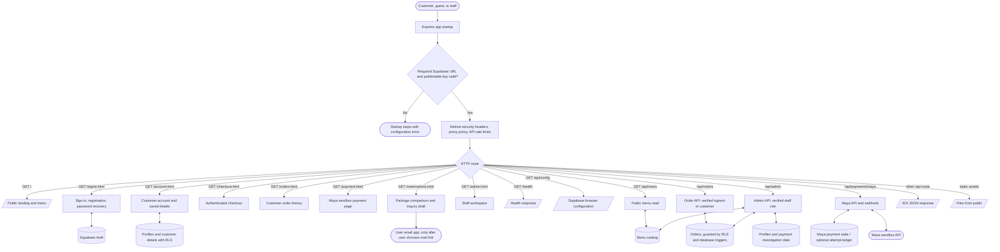
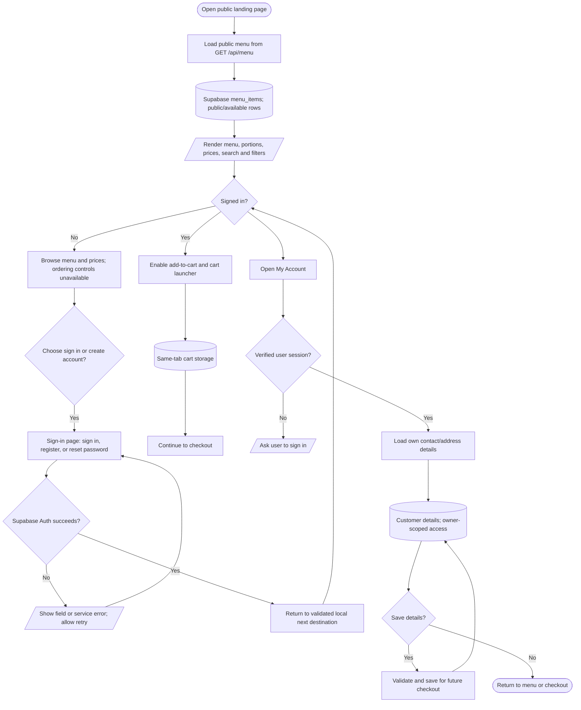
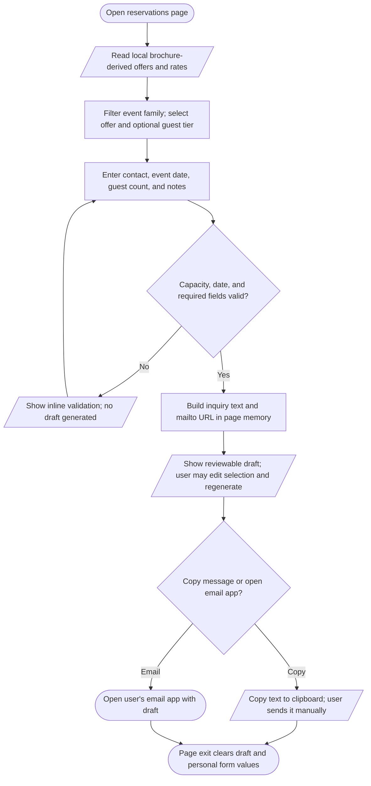
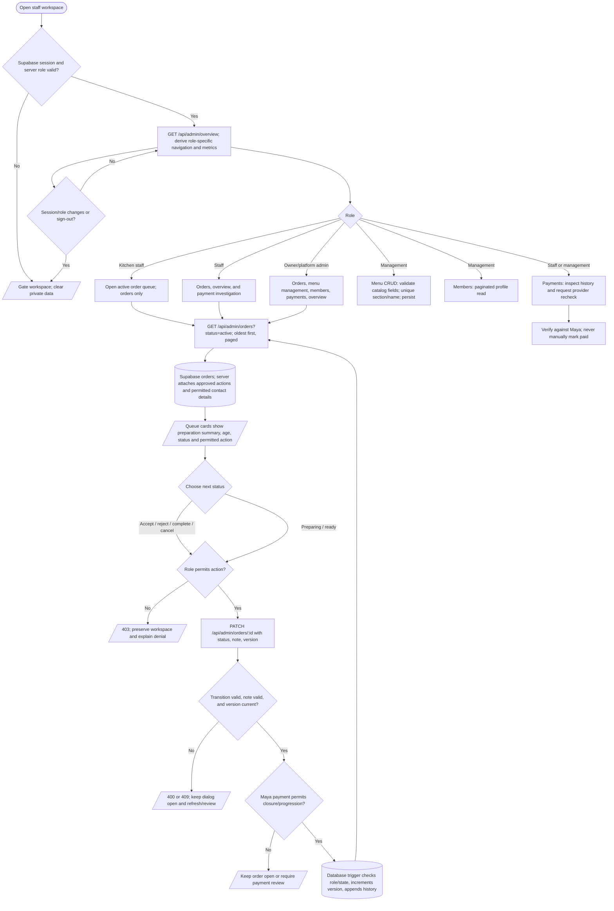
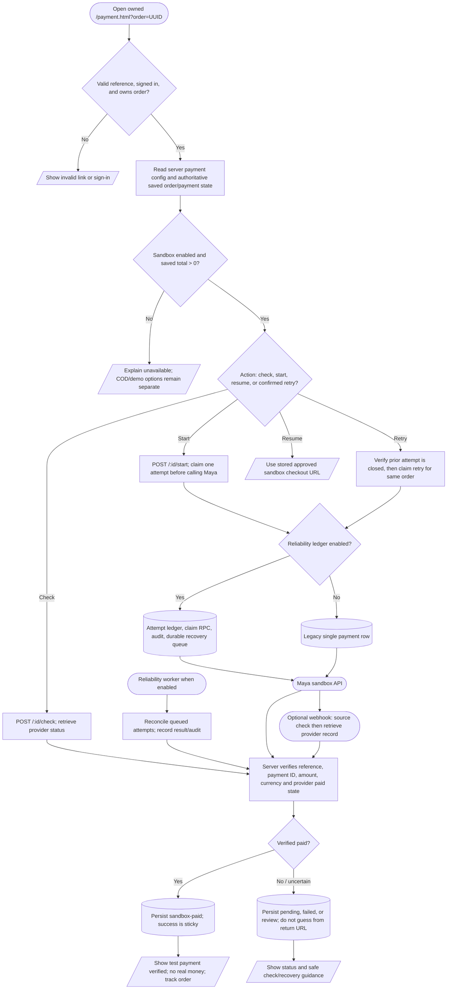

# Kathy's Hub — project logic flowchart

Reviewed against the current local source on 2026-10-20. This is a system-level map of the browser pages, Express API, Supabase persistence/authentication, and optional Maya sandbox. It is not a deployment diagram or a line-by-line call graph. The main route and data boundaries are shown; UI details that do not change the workflow are summarized.

## Shape identifier key

Each Mermaid node ID is a stable shape identifier. IDs use `AREA_NUMBER` (for example, `ORD_07`); edges use the node ID and should be updated if a node is renamed. Shapes follow common flowchart conventions:

| Shape | Meaning |
| --- | --- |
| `([ ... ])` | Start, end, or external actor/system |
| `[ ... ]` | Page, action, or process |
| `{ ... }` | Decision or validation gate |
| `[( ... )]` | Persistent store or external service |
| `[/ ... /]` | Input, output, or user-visible result |

## 1. Whole-project route and service map

## 2. Customer access, menu, and account

## 3. Checkout, idempotency, and customer order tracking

```mermaid
flowchart TD
  ORD_01([Open checkout]) --> ORD_02{Verified non-anonymous customer?}
  ORD_02 -- No --> ORD_03[/Show sign-in path; no order submission/]
  ORD_02 -- Yes --> ORD_04{Recover request ID in this tab for same user?}
  ORD_04 -- Yes --> ORD_05[GET /api/orders/request/:requestId]
  ORD_05 --> ORD_06{Saved order found?}
  ORD_06 -- Yes --> ORD_10[/Show saved order confirmation; avoid duplicate/]
  ORD_06 -- No --> ORD_07[Read cart and current public menu; reprice and validate choices]
  ORD_04 -- No --> ORD_07
  ORD_07 --> ORD_08{Cart has valid available items?}
  ORD_08 -- No --> ORD_09[/Explain empty, changed, or unavailable cart; return to menu/]
  ORD_08 -- Yes --> ORD_13[Show current total and customer/address form; optionally prefill saved details]
  ORD_13 --> ORD_14{Details valid and user submits?}
  ORD_14 -- No --> ORD_15[/Keep form editable; display validation or leave warning/]
  ORD_15 --> ORD_13
  ORD_14 -- Yes --> ORD_16[Keep random request ID plus owner in session storage; POST /api/orders]
  ORD_16 --> ORD_17{Server validates token, fields, unique lines, method, and request ID?}
  ORD_17 -- No --> ORD_18[/Return 401, 400, or service error; retain recovery path/]
  ORD_17 -- Yes --> ORD_19[(Supabase order insert: trigger verifies availability, variant price, total; writes pending + history)]
  ORD_19 --> ORD_20{Same owner/request ID already saved?}
  ORD_20 -- Matching request hash --> ORD_21[/Return prior order as reused/]
  ORD_20 -- Different request hash --> ORD_22[/409 recovery: load saved order or refresh changed menu/]
  ORD_20 -- New row saved --> ORD_23{Payment method?}
  ORD_21 --> ORD_23
  ORD_23 -- COD --> ORD_24[/Confirm saved order; unpaid; link to My orders/]
  ORD_23 -- Demo online --> ORD_25[/Confirm saved order; simulated only; link to My orders/]
  ORD_23 -- Maya sandbox --> PAY_01[Owned payment page: check existing attempt or start once]
  ORD_24 --> ORD_11[Customer order history]
  ORD_25 --> ORD_11
  PAY_01 --> ORD_11
  ORD_11 --> ORD_26[GET /api/orders; return only the authenticated user's orders]
  ORD_26 --> ORD_27[(Supabase orders, newest-first pages; attach authoritative Maya state)]
  ORD_27 --> ORD_28[/Render status history, payment label, refresh/retry and pagination/]
  ORD_28 --> ORD_29{Pending and customer requests cancellation?}
  ORD_29 -- No --> ORD_30([Refresh while visible; stop on hidden page or sign-out])
  ORD_29 -- Yes --> ORD_31[POST /api/orders/:id/cancel; owner + pending + version checks]
  ORD_31 --> ORD_32{Maya order?}
  ORD_32 -- No --> ORD_33[(Database transition guard marks cancelled and appends history)]
  ORD_32 -- Yes --> ORD_34[Verify/cancel provider session before closing order]
  ORD_34 --> ORD_35{Cancellation confirmed?}
  ORD_35 -- No --> ORD_36[/Keep order open; explain uncertain payment state/]
  ORD_35 -- Yes --> ORD_33
```

## 4. Reservations inquiry (client-only)

## 5. Staff workspace and order state transitions

**Order transition reference:** `pending → accepted | rejected | cancelled`; `accepted → preparing | rejected`; `preparing → ready | rejected`; `ready → completed`. Customer cancellation is limited to pending orders. Kitchen staff are limited to preparing/ready transitions, and Maya orders have additional verified-payment gates. Server and database checks remain authoritative even when the browser hides an action.

## 6. Maya sandbox payment and recovery

## Architecture review notes

- **Server trust boundary:** browser Supabase sessions are verified by the Express API for customer orders and staff routes. RLS and database triggers independently constrain order ownership, prices, transitions, history, and contact access.
- **Idempotent checkout:** a per-user request UUID and hash support recovery after uncertain saves. The browser stores only the request ID and user ID in tab storage; the server/database enforce uniqueness and reprice menu lines.
- **Privacy split:** kitchen responses omit customer contact fields; staff contact enrichment uses the explicitly authorized `order_contacts` database function and has no unrestricted fallback.
- **Reservations are not bookings:** package data and inquiry composition live in frontend modules. There is no reservation API or server persistence; the customer must send the generated email draft.
- **Payment remains sandbox-only:** Maya status is verified server-side against the provider. Reliability ledger/worker behavior is conditional on configuration and database setup; payment state never derives from a browser return URL.
- **Operations boundary:** this map describes local source only. It does not verify current Render deployment, live Supabase configuration, schema rollout, or provider account state.

## Main source map

| Flow | Main source files |
| --- | --- |
| Express routing and security | `server.js`, `server/app.js` |
| Public menu and cart | `public/js/pages/landing.js`, `public/js/menu.js`, `public/js/cart.js`, `public/js/cart-storage.js` |
| Authentication and account | `public/js/pages/auth.js`, `public/js/login.js`, `public/js/register.js`, `public/js/password-reset.js`, `public/js/pages/account.js`, `server/app.js` |
| Checkout and order protections | `public/js/pages/checkout.js`, `public/js/checkout-model.js`, `server/orders.js`, `supabase/orders-setup.sql` |
| Customer order history | `public/js/pages/orders.js`, `server/orders.js` |
| Reservations | `public/js/pages/reservations.js`, `public/js/reservation-offers.js`, `public/js/reservation-selection.js` |
| Staff workspace | `public/js/admin/main.js`, `public/js/admin/orders.js`, `public/js/admin/menu.js`, `public/js/admin/members.js`, `public/js/admin/payments.js`, `server/admin.js`, `server/roles.js` |
| Maya sandbox | `public/js/pages/payment.js`, `public/js/maya-handoff.js`, `server/maya-payments.cjs`, `server/maya-reliability.cjs`, `server/maya-client.cjs` |
| Core schema and access | `supabase/schema.sql`, `supabase/menu-catalog-setup.sql`, `supabase/orders-setup.sql`, Maya setup/verification SQL files |

For product behavior and UX acceptance criteria, see `PRODUCT.md`, `DESIGN.md`, `RESERVATIONS.md`, `MAYA_SANDBOX.md`, `PAYMENT_RELIABILITY.md`, and `UX_IMPROVEMENT_PLAN.md`.
